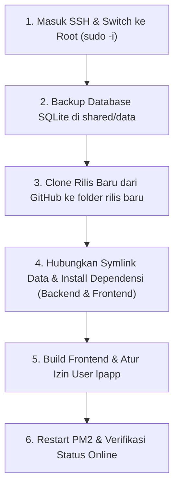

# Panduan Operasional & Prosedur Kerja Aman di VPS (Manual Deployment & Anti-Gagal)

> Dokumen ini adalah arsip prosedur UAT lama. Untuk produksi mulai 9 November 2026, gunakan [SOP aktif](../docs/SOP.md), [runbook](../docs/RUNBOOK.md) dan [status](../docs/STATUS.md). Jangan menjalankan instruksi backup/restore/root atau mengganti release dari arsip ini pada database produksi yang sudah memakai format baru.
**Sistem Aplikasi Layanan Pensiunan**  
*Versi Dokumen: 2.1 — Standar Keamanan & Operasional Produksi*

---

## 1. Pemahaman Arsitektur & Akun Server (Wajib Tahu)

Agar tidak terjadi kendala seperti `Permission denied`, `not a git repository`, atau `502 Bad Gateway`, Anda perlu memahami 3 aktor (user) dan struktur folder di VPS:

### A. Tiga Aktor (User) di VPS
| User | Peran & Wewenang | Kapan Digunakan? |
|---|---|---|
| **`layananpensiunan`** | Akun login SSH Anda dari laptop. Hak akses dibatasi (non-root) demi keamanan server. | Hanya untuk pintu masuk SSH awal. |
| **`root`** | Administrator tertinggi VPS. Memiliki hak penuh membuat folder, clone git, dan backup. | **Selalu aktifkan (`sudo -i`)** sebelum menyentuh file rilis atau database. |
| **`lpapp`** | User sistem tanpa password. Diciptakan khusus hanya untuk menjalankan proses Node.js/PM2 agar aman dari hacker. | Semua perintah PM2 harus dijalankan atas nama user ini (`sudo -u lpapp pm2 ...`). |

> [!IMPORTANT]
> **Aturan Emas Akun**: Begitu Anda login SSH ke VPS, **perintah pertama Anda selalu**:
> ```bash
> sudo -i
> ```
> *(Tanda prompt akan berubah menjadi `#`, menandakan Anda aman bekerja dengan hak administrator).*

---

### B. Anatomi Folder di `/srv/layanan-pensiunan/`

```text
/srv/layanan-pensiunan/
│
├── shared/                       <-- SANGAT KRUSIAL (DILARANG DIHAPUS)
│   └── data/
│       ├── enterprise.sqlite     <-- Database hidup tempat data nasabah & transaksi klien tersimpan!
│       └── enterprise_backup_*.sqlite <-- File cadangan otomatis
│
└── releases/                     <-- Tempat folder kode per versi
    ├── layanan-pensiunan-c693d42-uat/     (Rilis lama)
    └── layanan-pensiunan-uat-current/     (Rilis aktif sekarang)
        ├── backend/
        │   ├── data -> /srv/layanan-pensiunan/shared/data   (Symlink otomatis ke database asli)
        │   ├── node_modules/             <-- Wajib ada (hasil: npm install)
        │   └── src/server.js
        └── frontend/
            ├── dist/                     <-- Hasil compile (npm run build) yang dibaca browser
            └── node_modules/
```

> [!CAUTION]
> **Jangan Pernah Mengedit atau Menghapus Isi Folder `shared/data` Secara Sembarangan!**  
> Folder `releases/` boleh diganti atau dihapus versinya, tetapi folder `shared/data/` adalah tempat penyimpanan permanen database Anda.

---

## 2. Standar Emas 5 Langkah Rilis Manual (Zero-Mistake Workflow)

Gunakan panduan 5 langkah ini setiap kali Anda selesai melakukan `git push` dari laptop dan ingin memperbarui VPS:



---

### Langkah 0: Masuk ke Server & Beralih ke Root
Buka terminal (PowerShell atau Command Prompt laptop):
```bash
ssh layananpensiunan@139.190.106.136
```
Setelah berhasil masuk, langsung ketik:
```bash
sudo -i
```

---

### Langkah 1: Cadangkan Database Aktif (Safety Net)
Sebelum menyentuh kode apa pun, amankan database saat ini dengan salinan bertanggal:
```bash
cp /srv/layanan-pensiunan/shared/data/enterprise.sqlite /srv/layanan-pensiunan/shared/data/enterprise_backup_$(date +%Y%m%d_%H%M%S).sqlite
```
*Verifikasi backup berhasil dibuat:*
```bash
ls -lh /srv/layanan-pensiunan/shared/data/enterprise_backup_*.sqlite
```

---

### Langkah 2: Ambil Kode Terbaru dari GitHub ke Folder Rilis Baru
Masuk ke folder `releases` dan clone branch yang diinginkan:
```bash
cd /srv/layanan-pensiunan/releases

# Hapus folder rilis sementara sebelumnya jika namanya sama, lalu clone bersih:
rm -rf rilis-terbaru
git clone --depth 1 -b fix/security-and-operational-integrity https://github.com/roveradmin1st/layanan_pensiun.git rilis-terbaru
```

---

### Langkah 3: Siapkan Backend & Database
```bash
cd /srv/layanan-pensiunan/releases/rilis-terbaru/backend

# 1. Sambungkan folder database shared (agar backend membaca database yang sama)
ln -sfn /srv/layanan-pensiunan/shared/data data

# 2. Pasang library backend (Wajib agar tidak 502 Bad Gateway!)
npm install --omit=dev --prefer-offline --no-audit
```

---

### Langkah 4: Siapkan & Bangun Frontend
```bash
cd /srv/layanan-pensiunan/releases/rilis-terbaru/frontend

# Pasang dependensi frontend & compile kode
npm install --prefer-offline --no-audit
npm run build
```
*(Tunggu hingga muncul pesan `✓ built in ...s`)*.

---

### Langkah 5: Berikan Izin ke User `lpapp` & Restart Server
```bash
# 1. Berikan kepemilikan file rilis ke user lpapp
chown -R lpapp:lpapp /srv/layanan-pensiunan/releases/rilis-terbaru
chown -R lpapp:lpapp /srv/layanan-pensiunan/shared

# 2. Hentikan rilis lama di PM2 & jalankan rilis baru
sudo -u lpapp pm2 delete all || true
cd /srv/layanan-pensiunan/releases/rilis-terbaru/backend
sudo -u lpapp pm2 start src/server.js --name layanan-pensiunan-api
sudo -u lpapp pm2 save

# 3. Reload Nginx
systemctl reload nginx || true

# 4. Periksa status PM2
sudo -u lpapp pm2 status
```

**Selesai!** Status PM2 akan menampilkan warna hijau bertuliskan **`online`**. Anda bisa langsung membuka website di browser.

---

## 3. Panduan Cepat Penanganan Insiden (Troubleshooting Guide)

### Kasus A: Muncul `502 Bad Gateway (nginx)` di Browser
**Artinya**: Nginx normal, tapi aplikasi backend Node.js (port 4000) sedang mati/crash.

**Langkah Diagnosis**:
1. Cek log error PM2:
   ```bash
   sudo -u lpapp pm2 logs --lines 20
   ```
2. **Jika log tertulis `Cannot find module 'express'`**:
   Artinya Anda lupa menjalankan `npm install` di folder backend rilis baru!  
   *Solusi*: Masuk ke folder backend rilis Anda dan jalankan `npm install --omit=dev`, lalu `sudo -u lpapp pm2 restart all`.
3. **Jika log tertulis `SQLITE_CANTOPEN` atau `permission denied`**:
   Artinya user `lpapp` tidak memiliki izin menulis database.  
   *Solusi*: Jalankan `chown -R lpapp:lpapp /srv/layanan-pensiunan/shared`.

---

### Kasus B: Muncul `fatal: not a git repository`
**Artinya**: Anda menjalankan perintah `git fetch` atau `git pull` di dalam folder rilis lama yang bukan git repository.  
**Solusi**: Jangan `git pull` di folder rilis lama. Selalu gunakan `git clone` ke folder rilis baru seperti pada **Langkah 2** di atas.

---

### Kasus C: Prosedur Rollback Cepat 10 Detik (Jika Kode Baru Ada Bug)
Jika rilis baru memiliki masalah dan Anda ingin mengembalikan sistem ke versi stabil sebelumnya:
```bash
# Cukup arahkan kembali PM2 ke folder rilis lama yang stabil:
sudo -u lpapp pm2 delete all
cd /srv/layanan-pensiunan/releases/layanan-pensiunan-c693d42-uat/backend
sudo -u lpapp pm2 start src/server.js --name layanan-pensiunan-api
sudo -u lpapp pm2 save
```
Sistem langsung kembali ke versi lama dalam hitungan detik tanpa merusak database.

---

## 4. Cheat Sheet: Perintah yang Sering Dipakai di VPS

| Kebutuhan | Perintah Terminal VPS (Jalankan sebagai root) |
|---|---|
| **Cek status aplikasi PM2** | `sudo -u lpapp pm2 status` |
| **Cek log error aplikasi** | `sudo -u lpapp pm2 logs --lines 30` |
| **Restart aplikasi** | `sudo -u lpapp pm2 restart all` |
| **Cek penggunaan memori & CPU** | `htop` atau `free -m` |
| **Cek sisa kapasitas harddisk** | `df -h` |
| **Cek daftar file backup** | `ls -lh /srv/layanan-pensiunan/shared/data/enterprise_backup_*.sqlite` |
| **Cek status web server Nginx** | `systemctl status nginx` |
